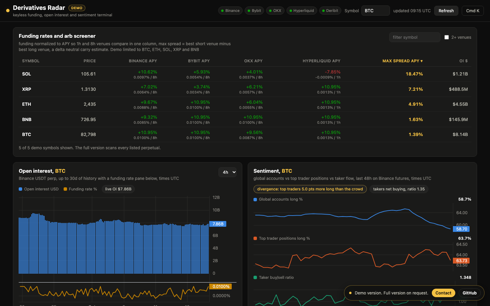

# Derivatives Radar

A keyless crypto derivatives terminal that merges four exchanges into one live view of funding, open interest, positioning and market regime, right in the browser.

**Live demo: https://artinbahmani.artin-bahmani0.workers.dev/derivatives-radar/**

## What it does

- **Cross-exchange funding in one column:** Binance, Bybit, OKX and Hyperliquid funding rates normalized to APY using each venue's real settlement interval, so 1h, 4h and 8h schedules compare directly.
- **Delta-neutral spread screener:** for every symbol, the best short venue minus the best long venue, ranked to surface the richest carry opportunities first.
- **Positioning and flow:** open interest history with a funding rate pane, plus global accounts vs top traders vs taker flow, with divergences called out in plain language.
- **Market regime:** Fear and Greed gauge with the full daily history since 2018 and a year-over-year comparison, and an implied vs realized volatility premium for BTC and ETH.
- **Risk map:** an RSI heatmap sized by market cap and estimated liquidation bands for 10x to 100x leverage, seeded from large hourly prints.

## How it works

- A single static page with no server and no API keys. Every figure is fetched from free public exchange endpoints and computed in the viewer's browser.
- One provider adapter per venue turns raw tickers into a common record shape. Settlement intervals come from each venue's own instrument metadata, with a heuristic fallback.
- A resilience layer keeps the screen useful when feeds misbehave: last-good caching with stale badges, request timeouts, and automatic fallback to Bybit where Binance is geo-blocked.
- The analytics (APY normalization, Wilder RSI, realized volatility, liquidation math, percentile seeding) run client-side as small pure functions.

## Stack

- Vanilla JavaScript, HTML and CSS, no framework
- TradingView Lightweight Charts, plus a custom canvas renderer for the liquidation bands
- Data: Binance, Bybit, OKX, Hyperliquid and Deribit public APIs, alternative.me Fear and Greed index, CoinGecko markets

## About the demo

The public demo is limited to the top 5 coins (BTC, ETH, SOL, XRP, BNB), has no data export and does not auto refresh. All figures are estimates computed from public data, not financial advice.

## Full version

Source code is private. To use it in your business or get the full version, contact me: artin.bahmani0@gmail.com

Copyright 2026 Artin Bahmani. All rights reserved.
